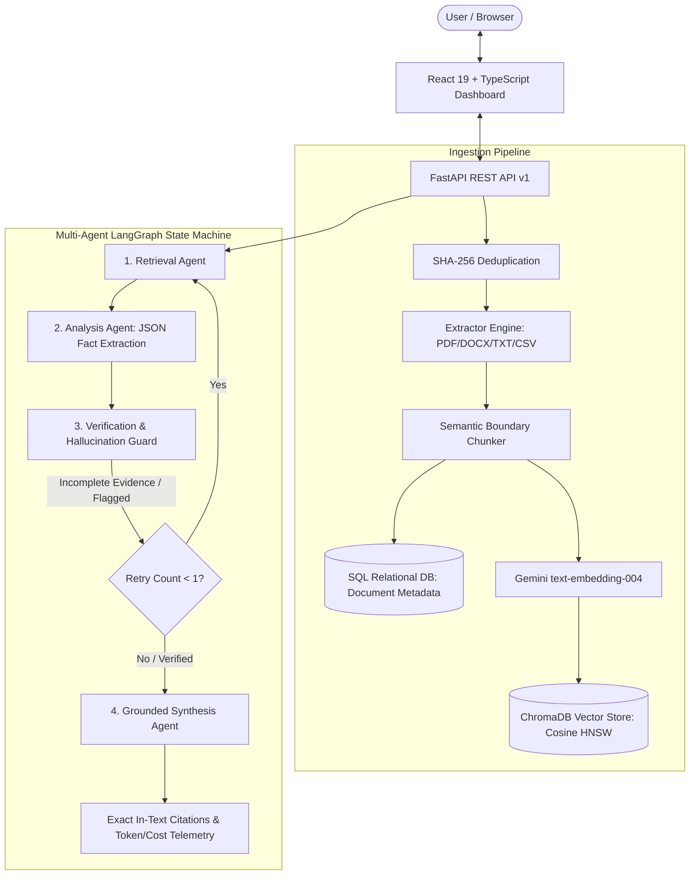

# NEXUS AI: Multi-Agent Enterprise Knowledge & Workflow Intelligence System

[](https://www.python.org/)
[](https://fastapi.tiangolo.com/)
[](https://langchain-ai.github.io/langgraph/)
[](https://ai.google.dev/)
[](https://react.dev/)

**NEXUS AI** is an enterprise-grade technical intelligence system designed to process heterogeneous enterprise documents (PDF, DOCX, TXT, CSV), extract semantic relationships, and execute multi-agent Retrieval-Augmented Generation (RAG) with strict fact verification, bracketed source citations, and exact token/cost tracking.

---

## 1. System Architecture



---

## 2. Key Capabilities

1. **Heterogeneous Document Processing**:
   - Automated ingestion for PDF (`pypdf`), DOCX (`python-docx`), TXT, and CSV (markdown tabular parsing via `pandas`).
   - Binary streaming with file size limits (25MB) and type whitelisting.
2. **SHA-256 Deduplication**:
   - Computes streaming hashes before indexing to eliminate redundant chunk embeddings and prevent vector space pollution.
3. **Task-Specific Embedding Vectors**:
   - Uses `text-embedding-004` (768-dim) with task-type differentiation: `RETRIEVAL_DOCUMENT` for chunk indexing and `RETRIEVAL_QUERY` for asymmetric user queries.
4. **LangGraph Multi-Agent Orchestration**:
   - **Retrieval Agent**: Semantic vector search with top-k budget expansion.
   - **Analysis Agent**: Synthesizes atomic facts into structured JSON.
   - **Verification Agent**: Audits facts against original chunks to prevent hallucinations; triggers cyclical retry when evidence is insufficient.
   - **Response Agent**: Produces grounded executive summaries with citations `[1]`, `[2]` and page numbers.
5. **Real-time Cost & Token Observability**:
   - Direct extraction of prompt and candidate token counts from `response.usage_metadata`.
   - Continuous dollar cost computation down to 6 decimal places based on model pricing schedules.
6. **Executive Enterprise UI**:
   - Dark-mode dashboard built with React 19, TypeScript, and Tailwind CSS.
   - Features Document Library, Knowledge Assistant, Agent Workflow Monitor, and Analytics views.

---

## 3. Technology Stack

- **Backend**: Python 3.11+, FastAPI, Pydantic v2, SQLAlchemy, Uvicorn
- **AI & Orchestration**: Google GenAI SDK (`gemini-2.5-flash`, `text-embedding-004`), LangGraph, LangChain Core
- **Vector Database**: ChromaDB (modular `VectorStoreBase` design ready for Google Vertex AI Vector Search / pgvector)
- **Frontend**: React 19, TypeScript, Vite, Tailwind CSS v4, Lucide React
- **Testing**: Pytest, Pytest-Asyncio, HTTPX

---

## 4. Getting Started

### Prerequisites
- Python 3.11+
- Node.js v18+
- Gemini API Key ([Google AI Studio](https://aistudio.google.com/))

### Backend Setup
```bash
# Clone the repository
git clone https://github.com/<your-username>/nexus-ai.git
cd nexus-ai/backend

# Create virtual environment
python -m venv ../venv
# Windows
..\venv\Scripts\Activate.ps1
# Linux/macOS
source ../venv/bin/activate

# Install dependencies
pip install -r requirements.txt

# Configure environment
cp .env.example .env
# Edit .env and paste your GEMINI_API_KEY

# Run tests
pytest -v

# Start FastAPI server
uvicorn app.main:app --reload --port 8000
```
Swagger API Documentation: `http://localhost:8000/docs`

### Frontend Setup
```bash
cd ../frontend

# Install packages
npm install

# Start Vite dev server
npm run dev
```
Access the Dashboard at: `http://localhost:5173`

---

## 5. Automated Test Suite

Run the full backend test suite covering extractors, chunkers, deduplication, vector storage, RAG citations, and LangGraph workflow state transitions:

```bash
cd backend
pytest -v
```

---

## 6. License
MIT License. Built for enterprise knowledge intelligence and cloud architecture demonstration.
